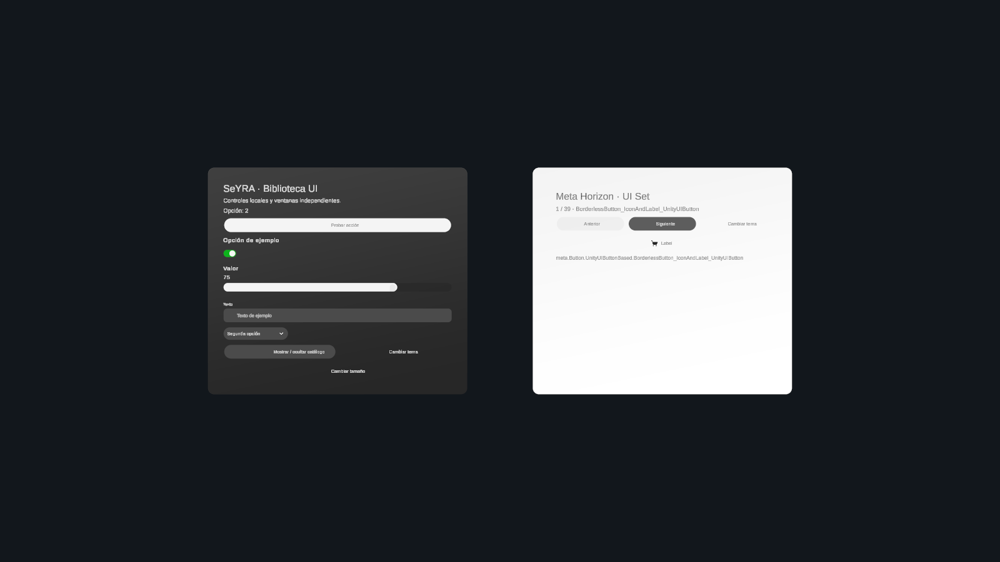

# UI phase 1 — library and windows

Date: 2026-10-27. Project: `C:/Proyectos/Seyra/SeyraUnity`.

## Delivered

Implemented the phase-1 UI library, preserving asset and script GUIDs
and checking for GUID collisions.
The project uses Unity 6000.3.21f1 and Meta XR 207.0.1.

- 20 semantic aliases + 39 native Meta UI Set catalog entries.
- 21 recovered component/window prefabs + 1 new demonstration prefab.
- Semantic theme, typed adapters, composition factory and shared geometry.
- Independent World Space windows with ray/poke surfaces and native grab borders.
- Reusable Editor generators, a component gallery and a two-window preview scene.
- English technical diagnostics and deliberately localized Spanish demo text.

Native assets retain package references. No SDK source was copied or PackageCache
modified. Removed the former `SpatialPlacementService` registration from the
window, the obsolete `GeometryQueryHelper` component from its prefab through
Unity's prefab API, and the phase-3 generator call. Chart/chat/room services were
not imported. The scene domain, transport, tools and saved-content format were not
changed by this phase.

## Validation performed

The running Unity Editor imported and compiled the library. Full library
regeneration completed, followed by successful validation of the generated assets.
The temporary authoring scenes preserved the original open scene.

`Seyra.Editor.SeyraUILibraryValidation.Run()` passed 436 checks:

- Catalog requirements, both Meta themes, all 22 prefabs, missing scripts and
  text font/material references.
- World Space Canvas at scale 0.001, two independent windows, ray/poke components,
  four trigger borders and persisted shared rail mesh.
- Canvas resizing refits border geometry while retaining window and Canvas pose.
- Open/close independence and theme changes.
- Invalid anchor, theme and nonfinite/zero dimensions reject without leaking windows.
- Literal text, button events, input updates, toggle, foldout, scrolling,
  composition scope isolation, removal and clearing.
- Instantiation/removal of all 39 native Meta entries.

`Seyra.Editor.SeyraUILibraryValidation.RunPreview()` passed 14 checks in Play Mode:

- Both windows and the single Meta canvas input module exist.
- A Unity pointer-click event reaches the action and updates its visible feedback.
- Toggle, slider, text input and dropdown update local preview state.
- Theme and resize buttons work; resize preserves window pose.
- Hiding/reopening the gallery preserves its instances and the other window's input.
- Gallery navigation cycles through all 39 native entries and wraps correctly.

A server-side frame-count wait confirmed that frames actually advanced. Final
console inspection reported no compilation failures and zero runtime errors.
The desktop XR runtime still reports unsupported optional OpenXR extensions and
an audio-output fallback; these are not evidence of a headset test.

Visual inspection confirmed two separate windows, dark/light themes, populated
controls, updated values and a closed dropdown without overlapping its neighbors.
The preview camera explicitly disables XR rendering through URP camera data;
the reusable window and demo prefabs remain XR-capable.

The window-preview scene originally lacked the scene-level Meta canvas module;
Play Mode exposed the assertion and it was fixed. Generators now reject attempts
to overwrite an already-open preview scene and check the scene-save result.
These fixes were included in the final successful run.

## Reproduce

In Edit Mode run the **Seyra > UI > Validate Library and Windows** menu command.
With the preview scenes closed, **Build Component Library** regenerates the assets
and scenes. Open **Open Window Preview**, enter Play Mode and test the controls,
or invoke `SeyraUILibraryValidation.RunPreview()` through Unity's script evaluator.

The demonstration scene is `Assets/Seyra/UI/Catalog/UIWindowPreview.unity`.
The reusable XR demonstration is `Assets/Seyra/UI/Catalog/UILibraryPreview.prefab`.
Its host scene must supply the existing rig and one `PointableCanvasModule`.

## Remaining scope

- Physical headset testing of reading comfort, ray/poke interaction, near/distance
  grab, rotation and two-hand scale preservation is still required.
- No panels are registered as generated content yet. Undo, trash and persistence
  integration belong to phase 2 and must use the existing versioned scene format.
- The twelve complete presentations and spatial chat remain phases 3 and 4.
- No room recognition or placement against physical walls/tables is introduced.
