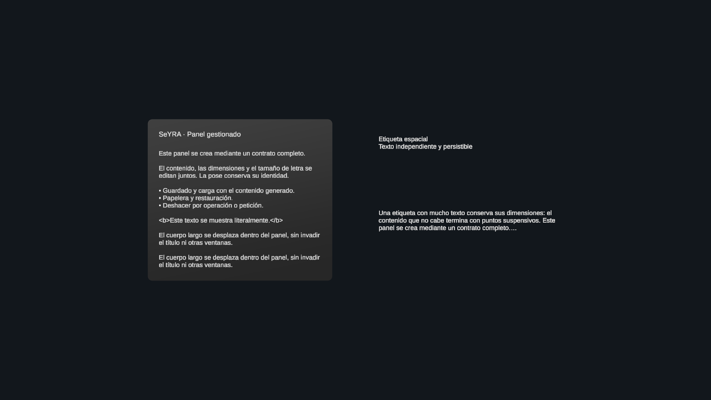

# UI phase 2 — managed panels, history and persistence

Validated on 2026-10-27 in Unity Editor 6000.3.21f1, Meta XR 207.0.1.

## Delivered

- `create_panel` and `update_panel` provide full semantic contracts for text
  windows and spatial labels, with explicit content/size limits and literal text.
- Panels participate in existing IDs, request groups, pose, relative placement,
  rename, reparenting, trash, restoration and operation/request undo.
- History and persistence treat each panel as one logical entity. Internal UI
  objects cannot be mutated or used as content parents through scene tools.
- Scene format v3 adds panel contracts and retains v1/v2 reading. Primitive
  appearances, slot locations, atomic writes, staging and load undo are reused.
- Native grab targets the logical root, making manual movement visible to the
  existing external-change conflict checks.
- Both existing runtime scenes have catalog references and scene-level canvas
  input configured through Unity's serialized-object/scene APIs.
- Both OpenCode profiles have identical instructions for the new capabilities;
  their existing permissions and provider settings are preserved.

The source project SeyraOld was not modified. No parallel persistence service or
new protocol was introduced. See [the exact contract](../bridge/PANELS.md).

## Validation results

- `npm test`: 5 tests passed, including strict complete panel/label schemas,
  numeric/text limits, literal whitespace/markup preservation, profile parity and
  actual local MCP transport checks.
- `PanelChecks.Run`: 217 assertions passed in Play Mode. Covers deduplicated
  creation; first-frame integrity; logical grab target; complete edits and undo;
  labels; all six placement directions; mixed scene save; one node per panel;
  trash/restore; undoing load with original instances; preserved entity IDs and
  new component IDs; rejected internal mutations; rejected external text edits
  without file overwrite; history conflict; invalid content/files; v1/v2 migration;
  a fresh runtime; grouped request undo; and envelope corners under rotated,
  negative/nonuniform parent scales.
- `LifecycleChecks.Run`: existing request/history/trash/atomic persistence and
  unsupported-component checks passed.
- `AppearanceChecks.Run`: six appearance styles, shader compilation, isolation,
  undo, six persistence round trips, v1 migration and resource cleanup passed.
  Historical fixture construction now removes the added v3 panel field and
  expects new saves to be version 3.
- `BoundsChecks.Run`: 5165 assertions and 96 placement cases passed.
- `RunUnityIntegration.Run`: actual MCP stdio → WebSocket bridge → Unity service
  passed, now including creation of both panel kinds, full update, undo and mixed
  v3 save/load alongside the original scene/primitive/appearance checks.
- Frame-count waits confirmed a ticking Play Mode loop. Final visual-run console
  inspection reported no compilation failures and zero runtime errors. Optional
  OpenXR extension/audio warnings remain in the desktop test environment.

The initial integrity check correctly exposed native SDK helpers added during
`Start`; those known transient helpers are excluded from authored structure.
First-frame checks passed afterward. Visual review also exposed low contrast in
unbacked labels; labels now use light semantic text with a dark outline.

## Visual evidence

The image shows a scrollable long body constrained below its heading, literal
`<b>` text, a separate readable spatial label and ellipsis for a bounded label.
The fixture uses the existing window-preview camera and isolated temporary
generated content; it does not save test content to a user's slot.

## Limits

Physical headset validation of reading comfort, grab, ray/poke and scroll remains
pending. Manual movement conflicts with undo rather than silently overwriting
the moved pose. Scroll position is local and resets on content replacement/load.
This phase does not add images, forms, twelve presentation types, chat UI, room
recognition, physical anchors or session persistence.

The new runtime reads v1/v2 files; old runtimes are not expected to read v3.
Existing limits of 128 undoable operations, 2048 logical live nodes, 8192 physical
retained objects and 5 MiB per slot remain enforced.
