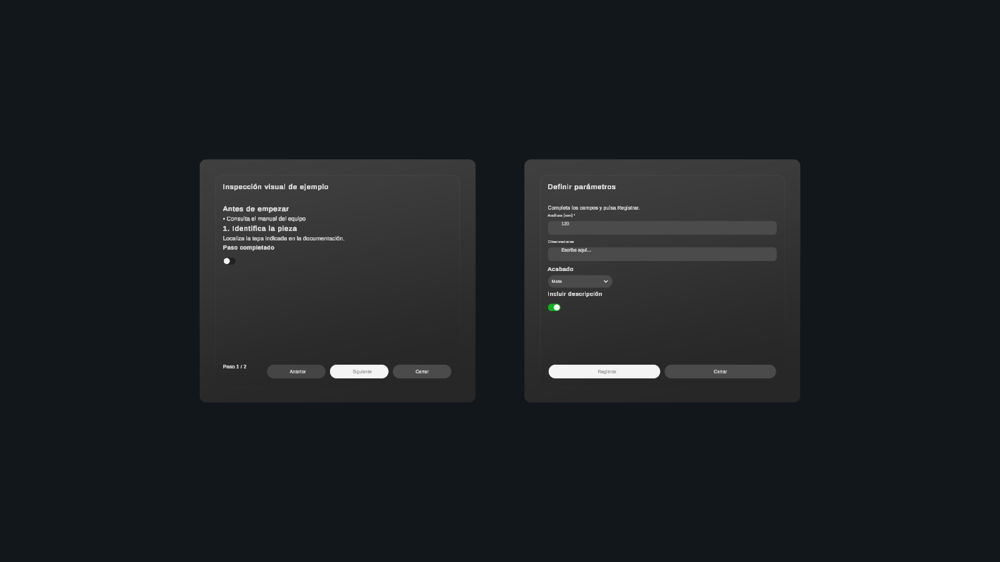

# UI phase 3 validation

Date: 2026-10-27. Unity 6000.3.21f1, Meta XR 207.0.1.

Implemented all twelve semantic presentation contracts and recovered prefab
bindings, integrated into the existing managed scene service. Nine UI tools share
the existing bridge, request grouping, history, trash and persistence. The old
project was read as a reference and was not modified.

## Executed checks

- TypeScript build and all six Node test suites passed. Both configured assistant
  profiles retain matching capabilities and permissions.
- Library validation: 628 checks passed across 34 prefabs, 20 aliases and 39
  native components, including the twelve recovered presentation prefabs.
- Shared corpus: twelve valid presentation types and eight invalid structural or
  relationship cases accepted/rejected consistently by TypeScript and Unity.
- `PresentationChecks.Run`: 209 assertions passed in Play Mode. Covers all twelve
  views, first-frame integrity, serialized script/grab references, media fallback,
  zoom/paging, guide/checklist/diagnostic/choice interaction, form validation and
  typed numeric submission, update reset, undo with interaction snapshots,
  identical-content replacement undo, transform undo preserving newer input,
  visibility, save/load, original-instance recovery, removal recovery, corrupted
  state rejection and the sixteen-window capacity.
- `PanelChecks.Run`: 223 assertions passed, including v1/v2/v3 migration to v4.
- Lifecycle and appearance checks passed, including conflict rejection, atomic
  storage and original component identity after undo.
- Bounds checks: 5,165 assertions and 96 placements passed.
- `RunUnityIntegration.Run`: actual MCP stdio bridge/WebSocket/runtime round trip
  passed, including all twelve `ui_present`/`ui_get` contracts, hide/show,
  pre-existing lifecycle/appearance/panel tests and v4 save/load/undo.

## Visual inspection

The captured guide and parameter form display titles, body, inputs, dropdown,
toggle and footer actions within separate managed windows. Input and dropdown
runtime helpers are accounted for by integrity tracking. The preview was generated
from the same complete contracts used by the tools, rather than manually editing
the prefab hierarchy.

Reproduce with `PresentationPreview.Create` in Play Mode in UIWindowPreview.
The test preview creates temporary generated content and is removed on stopping
Play Mode. The Editor was returned to the original preview scene in Edit Mode.

## Limits

Physical headset interaction, text comfort and performance have not been measured.
The image catalog supports registered sprites; production media registration is
still required for real assets. Missing references visibly fall back. Documents
are structured content, not parsed PDFs; work plans do not execute tasks.
Local UI actions do not automatically send conversation turns. Spatial chat and
room recognition are outside phase 3. See [contracts and state semantics](../bridge/PRESENTATIONS.md).
