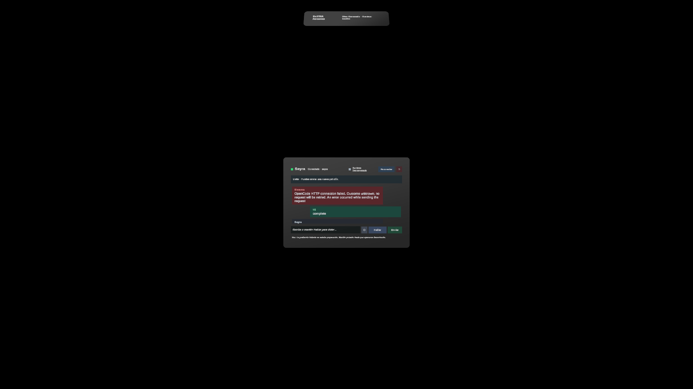

# UI phase 4 validation — Spatial Chat and Assistant Menu

Date: 2026-10-27. Unity 6000.3.21f1, Meta XR SDK 207.0.1.

Implemented Phase 4 of SeYRA UI: fully functional spatial conversation window and assistant menu in the `SeyraAssistant` scene, corresponding to roadmap item 06.
This revision incorporates critical architectural refactoring and feature alignments:
1. **Core conversation unification**: `OpenCodeConversationSession` is now the single, shared conversation engine handling all networking, turn states, permissions, monitoring, cancellation, and session continuity. The testbed `OpenCodeTestChat` was refactored into a thin UI presenter delegating 100% of network/turn operations to `OpenCodeConversationSession`, completely eliminating logic duplication while continuing to validate all 15 fault-injection requirements.
2. **Native Meta Voice SDK Push-to-Talk**: Per user requirements, the floating virtual keyboard in `SeyraAssistant.unity` was replaced with a Push-To-Talk voice dictation button (`PushToTalkButton` + `VoiceDictation`) utilizing Meta Voice SDK (`com.meta.xr.sdk.voice`). In Editor/PlayMode, it connects to Wit.ai using the PC microphone and `SEYRA_CLIENT_TOKEN`. In device builds, it leverages Meta platform dictation integrations.
3. **Unified Environment Credentials**: Implemented `SeyraEnvironmentCredentials` which reads `.env.local` from `Backend/.env.local` during Editor/PlayMode and from `Application.persistentDataPath/.env.local` in standalone builds. It extracts `OPENCODE_SERVER_PASSWORD` and `SEYRA_CLIENT_TOKEN` (with redaction utilities `[token oculto]`), ensuring zero secrets in assets or builds.
4. **Persistent Prefab Serialized References**: All button listeners are wired reliably in `Awake()` or serialized directly in the prefab assets, eliminating transient edit-time `AddListener` loss.
5. **Real Button & Pointer Interaction Validation**: `SpatialChatChecks` was updated to test real button clicks (`Button.onClick.Invoke()`) and pointer interactions on instantiated prefabs rather than bypassing UI controls.

## Delivered capabilities

1. **Spatial Chat Window (`SeyraSpatialChatWindow`)**:
   - Hosted inside a World Space millimeter `UIXRWindow` with native Meta XR manipulation: four grab colliders, rounded grab rail frame (`UIMetaGrabFrame`), ray interaction, and finger poke interaction surfaces.
   - Distinctive sender bubbles: User ("Tú", dark teal personal styling), Assistant ("Seyra", dark neutral styling), and Tool activity cards ("Herramienta", steel slate styling with Spanish human-readable tool titles).
   - Auto-scrolling conversation history viewport with clamped vertical scroll bounds.
   - Status header distinguishing OpenCode chat server connection from scene runtime bridge availability (`SeyraSceneRuntime.IsBridgeConnected`).
   - Turn execution status banner showing exact turn states (`Listo`, `Enviando`, `En ejecución`, `Esperando permiso`, `Cancelando`, `Completado`, `Interrumpido`, `Fallo`, `Resultado desconocido`).
   - Server permission request panel presenting requested action and formatted JSON details with explicit "Permitir una vez" (`once`) and "Rechazar" (`reject`) action buttons. Preserves `seyra_*: allow` and single-use decision submission guards.
   - Cancellation stops subsequent server tool dispatches without rollback claims; explicit turn closure via "Cerrar turno" required before starting a new prompt.
   - Reusable across hiding and reopening without duplicate connections or lost turns.

2. **Voice-to-Text & Text Composer (`VoiceDictation` + `PushToTalkButton`)**:
   - Push-to-talk button integrated in the composer row: hold while speaking, releases to transcribe and submit to chat.
   - Native Meta Voice SDK dictation service (`VoiceDictation`) configured at runtime with `SEYRA_CLIENT_TOKEN` from `.env.local`.
   - Visual audio capture feedback on the button (`idleColor`, `listeningColor`, `processingColor`, `unavailableColor`).
   - Text input field (`TMP_InputField`) and "✕" clear button available for typing, editing transcribed text, or using system soft keyboards.

3. **Spatial Assistant Menu (`SeyraSpatialMenu`)**:
   - Compact persistent dock window (`UIXRWindow`) providing accessible controls:
     - "💬 Chat" ("Mostrar chat" / "Ocultar chat"): toggles chat visibility while preserving session and history.
     - "🎯 Reubicar": smoothly repositions the chat window 1.2 meters directly in front of the active camera head pose, facing the user at eye level.
     - "🎙 Dictar": quick voice action button accessible from the dock.
     - Connection status dots for chat server and scene runtime bridge.

4. **Architecture & Scene Isolation**:
   - Root `/SeyraAssistantApp` is placed outside `/Generated`. The chat and menu belong to the application and are never modified, deleted, saved, or undone by scene tools.
   - Phase 3 semantic presentations and v4 persistence remain completely unaffected; local UI controls do not auto-dispatch chat turns.
   - `OpencodeTestUI` testbed preserved and verified against automated fault injection.

## Executed checks

- `SpatialChatChecks.Run`: 11 assertion groups passed in Play Mode in `SeyraAssistant.unity`:
  1. Hierarchy, grab frame, millimeter Canvas, and non-generated application isolation.
  2. Prefab button connections and input field clearing.
  3. Unified environment credentials reading and token redaction.
  4. Meta SDK Voice-to-Text and Push-to-Talk component presence and configuration.
  5. Fixture connection and v2 session creation.
  6. Push-to-Talk press/release, live transcription display, and voice prompt submission.
  7. Real send button click, permission panel display, allow once, tool summary, and turn completion.
  8. Cancellation via cancel button, no rollback claim, and explicit turn closure.
  9. Session and message continuity across hide and reopen without duplicate connections or controllers.
  10. Recenter button places chat window in front of user head pose.
  11. Runtime bridge availability distinguished from chat connection.
- `ChatExecutionChecks.Run`: all 15 automated fault-injection checks passed against the shared `OpenCodeConversationSession` engine in `OpencodeTestUI.unity` with exact prompt, interrupt, and permission counts.
- `PanelChecks.Run`: 223 assertions passed (persistence version 4).
- `PresentationChecks.Run`: 209 assertions passed across all 12 presentation types.
- `SeyraUILibraryValidation.Run()`: 814 checks across 36 prefabs, 20 aliases, and 39 native components passed.
- `npm test --prefix Backend/bridge`: all 6 test suites passed.
- Scene integrity verification: 0 missing scripts or broken references across `SeyraAssistant.unity` and `OpencodeTestUI.unity`.

## Visual inspection

The scene view captures both the `SpatialChatWindow` (with header, execution status banner, conversation viewport, composer with input field, clear button, push-to-talk voice button, send button, and voice hint label) and the `SpatialMenu` dock positioned in front of the XR camera rig.

## Limits

- Physical headset comfort, microphone sensitivity in noisy environments, and passthrough legibility in standalone Quest have not been measured on device (scheduled for roadmap item 07).
- Standalone Android network credentials loading from `Application.persistentDataPath/.env.local` and non-localhost backend transport configuration belong to roadmap item 07.
- Room mesh anchoring and MRUK surface snapping belong to P1 (roadmap item 13).
